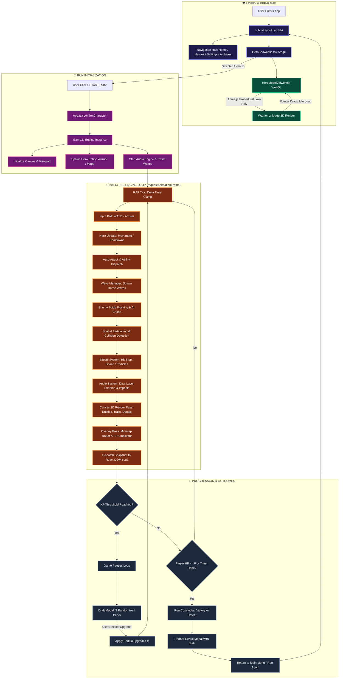
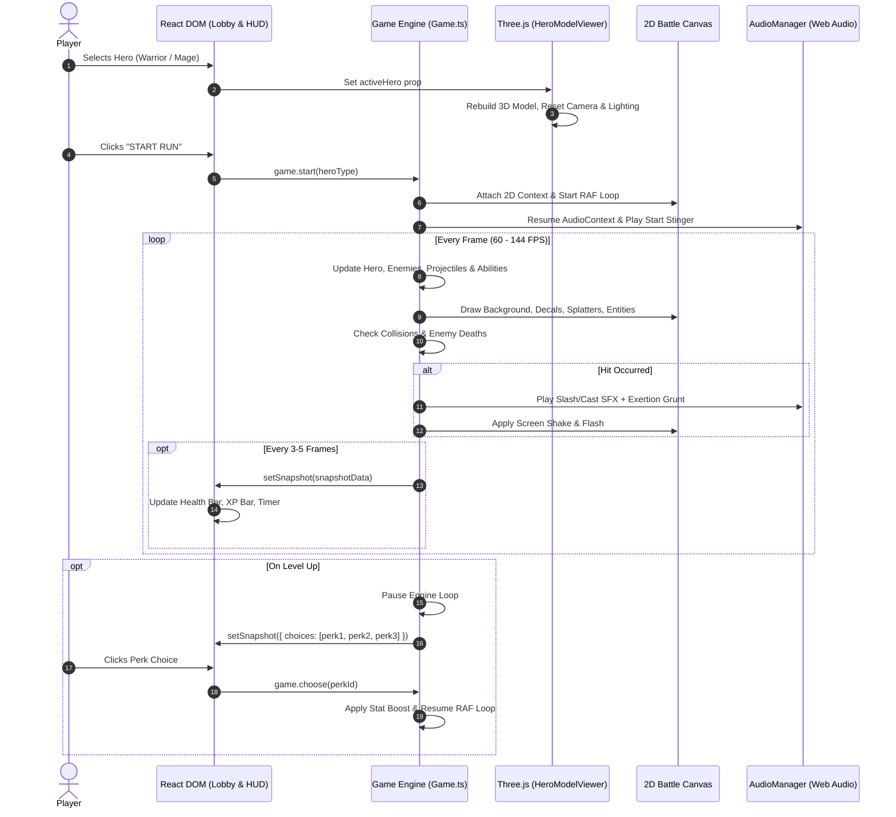

# ⚔️ Bonkfall V2

<p align="center">
  
  
  
  
  
  
  
  
</p>

<p align="center">
  <strong>A high-octane dark fantasy roguelite survival game built with a custom decoupled 2D Canvas Engine, interactive 3D WebGL Three.js character showcases, and a responsive React 19 interface.</strong>
</p>

---

## 📑 Table of Contents

- [⚔️ Bonkfall V2](#️-bonkfall-v2)
  - [📑 Table of Contents](#-table-of-contents)
  - [🌟 Overview](#-overview)
  - [🏗️ System Architecture \& Flowchart](#️-system-architecture--flowchart)
    - [Interactive Engine Lifecycle](#interactive-engine-lifecycle)
    - [Decoupled React-Canvas Data Pipeline](#decoupled-react-canvas-data-pipeline)
  - [📂 Codebase Structure](#-codebase-structure)
    - [Directory Tree](#directory-tree)
    - [Major Files \& Modules Breakdown](#major-files--modules-breakdown)
  - [🧙 3D Procedural Hero Showcase Engine](#-3d-procedural-hero-showcase-engine)
    - [🛡️ Iron Vanguard (Warrior)](#️-iron-vanguard-warrior)
    - [🔮 Archmage (Mage)](#-archmage-mage)
  - [👾 Procedural Horror Swarm \& Combat Juice](#-procedural-horror-swarm--combat-juice)
  - [🎵 Web Audio Synthesis \& Sound Pools](#-web-audio-synthesis--sound-pools)
  - [🎮 Controls \& Keybindings](#-controls--keybindings)
  - [🛠️ Installation \& Development](#️-installation--development)
    - [Prerequisites](#prerequisites)
    - [Quick Start](#quick-start)
    - [Available Scripts](#available-scripts)
  - [🤝 Contributing](#-contributing)
  - [📄 License](#-license)

---

## 🌟 Overview

**Bonkfall V2** is an open-source survivor-like roguelite browser game set in the corrupted lands of the *Verdant Expanse*. Players select a hero, engage escalating hordes of procedural horrors, collect experience orbs (XP), draft synergistic perks upon leveling up, and fight to survive until the timer expires.

### Key Architectural Pillars:
1. **Decoupled 2D Canvas Engine**: The real-time simulation runs entirely on a hardware-accelerated HTML5 2D Canvas loop via `requestAnimationFrame`. Zero React DOM reconciliation occurs during combat, ensuring stable 60–144 FPS under swarms of 500+ entities.
2. **Interactive 3D WebGL Lobby**: The hero selection stage runs a high-performance Three.js WebGL viewport rendering procedurally generated, low-poly 3D models with real-time lighting, cast shadows, idle breathing tweens, and 360° mouse drag interaction.
3. **State Snapshots**: The game engine communicates with the React UI exclusively through an immutable `Snapshot` interface, allowing React to handle HUD updates, drafting menus, and game-over modals without interfering with the render cycle.
4. **Procedural Synthesis Audio**: Dynamic sound effects generated via Web Audio API oscillators and gain envelopes with pitch-randomization shuffle bags, eliminating repetitive sound fatigue.

---

## 🏗️ System Architecture & Flowchart

### Interactive Engine Lifecycle

The diagram below illustrates the complete lifecycle from lobby navigation to in-game wave processing, level-up drafting, and run completion:



### Decoupled React-Canvas Data Pipeline



---

## 📂 Codebase Structure

### Directory Tree

```
bonkfall-v2/
├── public/                     # Static game assets, icons, and audio files
├── src/
│   ├── components/             # React presentation components
│   │   └── lobby/              # Full-viewport Lobby SPA system
│   │       ├── views/          # Sub-screens mounted within the Lobby Rail
│   │       │   ├── ArchivesView.tsx    # Monster bestiary, unlocked relics, run history
│   │       │   ├── HeroSelectView.tsx  # Hero stat radar, class lore, passive abilities
│   │       │   ├── HomePlayView.tsx    # Central hero card, mission briefing, controls
│   │       │   └── SettingsView.tsx    # Target FPS, master volume, screen shake toggle
│   │       ├── HeroModelViewer.tsx     # Three.js 3D procedural WebGL viewport
│   │       ├── HeroShowcase.tsx        # Central card stage, 2.5D tilt & loadout switch
│   │       ├── LobbyLayout.tsx         # Responsive layout container & persistent rail
│   │       └── lobby.css               # Lobby styling, glassmorphism, animations
│   ├── config/
│   │   └── characters.ts       # Hero specifications, stat baseline, UI accents
│   ├── data/
│   │   └── upgrades.ts         # Roguelite upgrade tree, tiers, weights, and stat multipliers
│   ├── effects/
│   │   └── Effects.ts          # Particle systems, blood decals, hit-stop, camera shake
│   ├── engine/
│   │   ├── AudioManager.ts     # Procedural Web Audio API synthesizer & sound pools
│   │   ├── Game.ts             # Central 2D survival engine, RAF loop, wave orchestrator
│   │   └── Overlay.ts          # High-performance minimap radar & FPS telemetry
│   ├── entities/
│   │   ├── Abilities.ts        # Orbiting orbs, chain lightning, fire aura, frost nova
│   │   ├── Enemy.ts            # Procedural swarm logic, sine jitter, boids separation
│   │   ├── Mage.ts             # Mage hero controller, ranged missile mechanics
│   │   ├── Projectiles.ts      # Homing arcane missiles, piercing bolts, enemy projectiles
│   │   └── Warrior.ts          # Warrior hero controller, kinetic slash combos, shield
│   ├── hooks/
│   │   ├── useLobbyNavigation.ts # Navigation state, keyboard shortcuts (1-4, Esc)
│   │   └── useLobbyState.ts      # Volume settings, selected hero persistence
│   ├── App.tsx                 # Root React component, game-to-DOM bridge, modal manager
│   ├── main.tsx                # React DOM root entry point
│   ├── styles.css              # Global tokens, HUD styling, modal backdrops
│   └── types.ts                # TypeScript interfaces (Snapshot, Result, Upgrade, Enemy)
├── index.html                  # HTML entry point with dark fantasy theme metadata
├── package.json                # Project dependencies, scripts, and engine metadata
├── tsconfig.json               # TypeScript compiler configuration (ESNext, React-JSX)
└── vite.config.ts              # Vite 7 build configuration with React plugin
```

### Major Files & Modules Breakdown

| File | Primary Responsibility | Key Features & Implementation |
| :--- | :--- | :--- |
| **[`src/engine/Game.ts`](file:///d:/BonkFall/bonkfall-v2/src/engine/Game.ts)** | Core 2D Game Engine | Manages the main `requestAnimationFrame` loop, target FPS frame-capping (60/144 FPS), smooth camera lerp, spatial enemy collision grid, wave progression, and clean lifecycle teardown (`destroy()` / `stop()`). |
| **[`src/components/lobby/HeroModelViewer.tsx`](file:///d:/BonkFall/bonkfall-v2/src/components/lobby/HeroModelViewer.tsx)** | 3D WebGL Hero Showcase | Pure Three.js procedural modeling without external 3D model asset bloat. Renders Warrior and Mage with custom shaders, PBR materials, multi-point studio lighting, idle bobbing, and 360° mouse-drag rotation. |
| **[`src/components/lobby/LobbyLayout.tsx`](file:///d:/BonkFall/bonkfall-v2/src/components/lobby/LobbyLayout.tsx)** | Lobby Navigation & Layout Shell | Dark fantasy roguelite UI adhering to strict `100dvh` viewport boundaries. Features a left navigation rail, global mute toggle, audio synchronization, and responsive modal transitions. |
| **[`src/components/lobby/HeroShowcase.tsx`](file:///d:/BonkFall/bonkfall-v2/src/components/lobby/HeroShowcase.tsx)** | Centerpiece Hero Card | Mounts the 3D model viewer, provides hero switching arrows (`Warrior` / `Mage`), applies mouse-driven 2.5D perspective tilt, and displays class badges. |
| **[`src/engine/AudioManager.ts`](file:///d:/BonkFall/bonkfall-v2/src/engine/AudioManager.ts)** | Polyphonic Audio Engine | Uses Web Audio API oscillator nodes, bandpass filters, and exponential gain curves for procedural sword slashes, spell whooshes, and grunt exertions with pitch jitter (±8%). |
| **[`src/entities/Enemy.ts`](file:///d:/BonkFall/bonkfall-v2/src/entities/Enemy.ts)** | Procedural Swarm Logic | Procedurally rendered eldritch entities using sine-wave vertex jitter (`performance.now()`). Implements boids-like flocking separation forces to prevent unnatural clustering. |
| **[`src/effects/Effects.ts`](file:///d:/BonkFall/bonkfall-v2/src/effects/Effects.ts)** | Combat Feel & "Game Juice" | Handles camera screen shake decay, micro hit-stop frame freezing on critical blows, momentum-preserving blood splatters, and kinetic slash trails. |
| **[`src/engine/Overlay.ts`](file:///d:/BonkFall/bonkfall-v2/src/engine/Overlay.ts)** | Hardware Minimap & Telemetry | Draws an isolated radar minimap showing player position, swarming enemies, and XP clusters with zero heap garbage collection. |
| **[`src/data/upgrades.ts`](file:///d:/BonkFall/bonkfall-v2/src/data/upgrades.ts)** | Roguelite Progression Registry | Defines randomized stat upgrades (Might, Haste, Magnet, Max HP, Armor) and active powers (Orbiting Orbs, Lightning Strike, Fire Aura). |
| **[`src/App.tsx`](file:///d:/BonkFall/bonkfall-v2/src/App.tsx)** | Root React Orchestrator | Hooks into `Game.ts` via state callbacks, renders the HUD during combat, handles level-up drafting overlays, and displays the run summary screen. |

---

## 🧙 3D Procedural Hero Showcase Engine

Inside [`HeroModelViewer.tsx`](file:///d:/BonkFall/bonkfall-v2/src/components/lobby/HeroModelViewer.tsx), the lobby renders real-time 3D models generated procedurally using low-poly Three.js geometries (`flatShading: true`) with zero external `.glb` download latency.

### 🛡️ Iron Vanguard (Warrior)
- **Barbute Greathelm**: Cylindrical low-poly dome, reinforced brow guard, cheek flaps, and a vertical crest fin (`0xeab308`), centered with an emissive cyan visor slit (`0x00f2ff`).
- **Pectoral Armor & Pauldrons**: Layered beveled shoulder guards with gold trim, segmented breastplate, and a heavy leather waist belt with buckle.
- **Weaponry**:
  - **Spiked Kite Shield**: Emblazoned with a gold heraldic cross and a center pyramid spike.
  - **Knight's Claymore**: Steel blade with a central blood-groove fuller, crossguard quillons, wire-wrapped hilt, and counterweight octagonal pommel.
- **Lighting**: Dramatic amber rim light (`0xf59e0b`, intensity `3.6`) and top-front key light with real-time soft shadow mapping.

### 🔮 Archmage (Mage)
- **Wrinkled S-Curve Wizard Hat**: Four organically segmented cylinders forming an authentic S-curve lean and drooping tip, accented with crease rings (`TorusGeometry`), a wavy-dipped brim, a thick gold strap (`0xeab308`), and a 3D geometric brooch (`0xd97706`).
- **Expressive Low-Poly Face**:
  - **Face Plate**: Defined ivory/pale flesh tone (`0xf1ede4`) under the hat shadow.
  - **Eyes with Black Pupils**: White flat-shaded sclera meshes (`0xffffff`), framed by a subtle cyan arcane rim (`0x38bdf8`), with distinct pitch-black pupil cores (`0x111111`, `MeshBasicMaterial`) that remain sharp in all lighting conditions.
  - **Separated Mustache & Beard**: Two outward-flaring mustache wings framing a 3-tiered cascading beard (`0xf1f5f9`, `0xe2e8f0`, `0xcfd8dc`) with stepped forward depth offsets.
- **Dedicated Face Illumination**: A local point light (`0xffffff`, intensity `0.85`, distance `2.0`) positioned directly in front of and slightly below the face, eliminating dark brim shadows.
- **Spellcasting FX**: Floating mystic staff topped with a crystal cluster, paired with an animated orbiting spell sphere in the off-hand with dual counter-rotating energy rings.

---

## 👾 Procedural Horror Swarm & Combat Juice

Bonkfall V2 replaces standard sprite sheets with real-time procedural drawing algorithms to maximize performance and visual punch:

* **Sine-Wave Vertex Wriggling**: Swarm enemies jitter and pulsate dynamically based on trigonometric functions of `performance.now()`, giving them a visceral, unsettling movement pattern.
* **Boids Flocking Separation**: A spatial proximity repulsion algorithm prevents hundreds of enemies from stacking into a single pixel, creating dynamic, writhing horde shapes that surround the player.
* **Squash & Stretch Deformation**: Enemies dynamically compress along their axis of impact when struck, flashing pure white (`#ffffff`) for 2 frames before returning to normal tone.
* **Hit-Stop Microfreezes**: Critical impacts briefly pause the delta-time calculation for 30–60 milliseconds, delivering satisfying kinetic weight to heavy attacks.
* **Momentum-Preserving Decals**: Slain enemies burst into physical blood splatter particles that inherit their knockback velocity and settle onto the arena floor.

---

## 🎵 Web Audio Synthesis & Sound Pools

The sound engine in [`AudioManager.ts`](file:///d:/BonkFall/bonkfall-v2/src/engine/AudioManager.ts) is entirely zero-dependency and built on the native Web Audio API:

* **Dual-Layer Combat Audio**: Every melee or ranged attack triggers two synchronized audio nodes:
  1. **Impact / Whoosh Layer**: White noise burst filtered through a dynamic bandpass frequency sweep.
  2. **Vocal Exertion Layer**: Low-frequency resonant triangle waves simulating vocal grunts or arcane chants.
* **Anti-Repetition Shuffle Bag**: Sound variations are pulled from a randomized bag to avoid repeating identical waveforms consecutively.
* **Pitch Modulation**: Each playback applies a dynamic pitch jitter of **±8%**, ensuring no two slashes or spellcasts sound identical.
* **Global Mute State**: Integrated master volume control that smoothly ramps gain to 0 without clicking or pop artifacts.

---

## 🎮 Controls & Keybindings

| Action | Primary Key | Secondary Key | Description |
| :--- | :--- | :--- | :--- |
| **Move Up** | `W` | `↑ Up Arrow` | Move hero northward |
| **Move Down** | `S` | `↓ Down Arrow` | Move hero southward |
| **Move Left** | `A` | `← Left Arrow` | Move hero westward |
| **Move Right** | `D` | `→ Right Arrow` | Move hero eastward |
| **Auto-Attack** | *Automatic* | *Automatic* | Attacks automatically trigger toward nearest foe |
| **Pause / Resume** | `Escape` | `P` | Toggles game pause during an active run |
| **Select Perk** | `Click` | `1` / `2` / `3` | Draft an upgrade during level-up events |
| **Lobby Navigation** | `Click` | `1` - `4` | Hot-swap between Home, Heroes, Settings, Archives |
| **Rotate 3D Hero** | `Left Click + Drag` | `Touch Drag` | Orbit 360° around the 3D model in the lobby |

---

## 🛠️ Installation & Development

### Prerequisites

- **Node.js**: `v18.0.0` or higher (LTS recommended)
- **NPM**: `v9.0.0` or higher
- **Modern Browser**: Chrome, Firefox, Edge, or Safari with WebGL & Web Audio support

### Quick Start

1. **Clone the repository:**
   ```bash
   git clone https://github.com/GururajNaik2807/BonkFall.git
   cd BonkFall/bonkfall-v2
   ```

2. **Install dependencies:**
   ```bash
   npm install
   ```

3. **Start the local development server:**
   ```bash
   npm run dev
   ```

4. **Open in browser:**  
   Navigate to the local URL displayed in your terminal (usually `http://localhost:5173`).

### Available Scripts

| Command | Action |
| :--- | :--- |
| `npm run dev` | Starts the Vite dev server with Hot Module Replacement (HMR). |
| `npm run build` | Compiles TypeScript via `tsc -b` and builds the optimized production bundle with Vite. |
| `npm run preview` | Locally serves the production build in `./dist` for validation. |

---

## 🤝 Contributing

Contributions are welcomed! Whether you want to add new hero archetypes, balance upgrade synergies, introduce enemy mutations, or polish UI themes:

1. **Fork the Project** (`https://github.com/GururajNaik2807/BonkFall/fork`)
2. **Create your Feature Branch:**
   ```bash
   git checkout -b feature/NewHeroClass
   ```
3. **Commit your Changes:**
   ```bash
   git commit -m "feat: Add Ranger class with piercing arrows and dodge roll"
   ```
4. **Push to your Branch:**
   ```bash
   git push origin feature/NewHeroClass
   ```
5. **Open a Pull Request** describing your additions and screenshots where relevant.

---

## 📄 License

Distributed under the **MIT License**. See `LICENSE` for more information.

<p align="center">
  <sub>Built with ⚔️ by the Bonkfall Team. Powered by React 19, Three.js, and Vite.</sub>
</p>
